# 🐝 daemonhive

**A small hive of personal AI agents living in one cluster, reachable through one Telegram bot.**

Each agent owns one slice of my life and keeps its own private database. When one needs something from another, it doesn't sneak into its tables. It asks over **A2A**. Everything they learn about me goes into a shared **temporal knowledge graph**, so "my bench stalled the week I slept 5 hours" is a fact the system can remember and reason about later.


| agent | owns | does stuff like |
|---|---|---|
| 🟣 **Concierge** | the Telegram conversation | figures out who should handle a message, merges answers |
| 🟠 **Fitness** | workouts, progression | parses `Bench Press 120kg 3x3 RPE 7`, spots PRs and regressions |
| 🟢 **Well-being** | sleep, food, body weight | answers "how did I recover this week?" with summaries, never raw rows |
| 🔵 **Work** | tasks, calendar | places deep-work blocks, and avoids 8 AM after a short night |
| 🟡 **Scribe** | memory quality | nightly CronJob: merges duplicate entities, closes stale facts |

---

## the one scenario that explains everything


1. I paste my push-day log into Telegram.
2. Concierge sees it matches the workout grammar and routes it to Fitness. **No LLM call.**
3. Fitness parses it, stores it, compares with last push day: bench went from 3x8 to 3x3 at the same weight, **−62% volume**.
4. Fitness asks Well-being over A2A: *"recovery over the last 3 days?"* Well-being answers from its own DB: 5.2 h average sleep, 600 kcal/day under target.
5. Fitness writes `Session —AFFECTED_BY→ SleepDeficit` into the graph with a validity date and sends me one short, honest message.
6. Next week, Work reads the graph and pushes my deep-work block to 11:00 the morning after a bad night.

That scenario runs as a test (`tests/test_reference_scenario.py`) with the real agent logic and fake peers. It asserts the exact **trajectory** (`parse → MCP → A2A → memory → tier-2 message`), the **graph end state**, and what happens when Well-being is down (Fitness still reports the regression, just without the why).

---

## MCP vs A2A, the short version

- **MCP** = agent → *tools and data*. Fitness talks to `fitness-db` and `memory` MCP servers.
- **A2A** = agent → *another agent*. Each agent publishes an Agent Card at `/.well-known/agent-card.json` listing its skills. Callers send tasks, and the callee stays a black box with its own tools and memory.

Why not just let Fitness read the sleep table? Because then Fitness knows Well-being's schema, can read every meal I've logged, and breaks whenever that table changes. With A2A it gets exactly one aggregate, and only because it's on the skill's allow-list.

## memory that knows *when*

Graphiti on Neo4j behind `memory-mcp`. Facts carry validity intervals, so "weight was 82 kg" doesn't get deleted when it becomes 80 kg. It gets closed. You can ask what was true on any date.

Permissions are enforced **in the MCP server**, not the prompt (`mcp/permissions.py`):
- Fitness can write `Session` facts and `AFFECTED_BY` edges. It can't touch `Project` or read `Habit`.
- every read and write, allowed or denied, lands in an audit log.
- a prompt injection hidden in a workout note can't widen any of that (there's a test for it).

## spend tokens only where code can't



Workout parsing is a grammar. Regression detection is arithmetic. Reminders are cron. Only ambiguous routing hits a small model, and only the message I actually read hits a big one. Every agent has its own LiteLLM virtual key with its own monthly budget and a hard stop. Concierge exposes `/stats` with the share of events handled per tier.

---

## run it ($0, local models)

Everything runs on one machine: models in LM Studio, the hive in Docker. The full walkthrough (Telegram bot, seeding a week of data, replaying the scenario, watching the graph in Neo4j) is in **[DEMO.md](DEMO.md)**. Short version:

```bash
cp .env.example .env        # telegram token + your chat id; models default to LM Studio
make dev && make test       # parser, analysis, A2A, permissions, scenarios
make up                     # agents + postgres + neo4j + nats + litellm (-> LM Studio on :1234)
```

Memory runs on `MEMORY_BACKEND=cypher` by default: agents already hand memory a structured fact, so it goes straight into Neo4j with no LLM in the loop. Set it to `graphiti` to have free-text episodes extracted by a model instead.

## layout

```
src/daemonhive/
  common/
    a2a.py          agent cards, task server/client, caller allow-lists
    events.py       NATS subjects, idempotent consumer, dead-letter
    tiers.py        tier 0/1/2 + ledger
  agents/
    concierge/      rules-first routing, fan-out over A2A
    fitness/        grammar parser, PR/regression analysis, the scenario agent
    wellbeing/      recovery summary skill
    work/           deep-work planner + morning brief CronJob
    scribe/         entity merging, fact invalidation, nightly job
  mcp/              memory (Graphiti) + fitness-db servers, permission guard
  gateway/          telegram bot, one allowed chat id
scenarios/          offline harness: real agents, fake peers
db/schema.sql       one schema per agent, one role per agent
deploy/helm/        a Deployment + Service + NetworkPolicy per agent, CronJobs
```

## things I would not do again

- start with five agents. Start with one, hand-written, and split only when one agent's context gets crowded.
- let agents share a database "temporarily". It's never temporary.
- trust the prompt as a permission boundary. It isn't one.

## license

MIT
