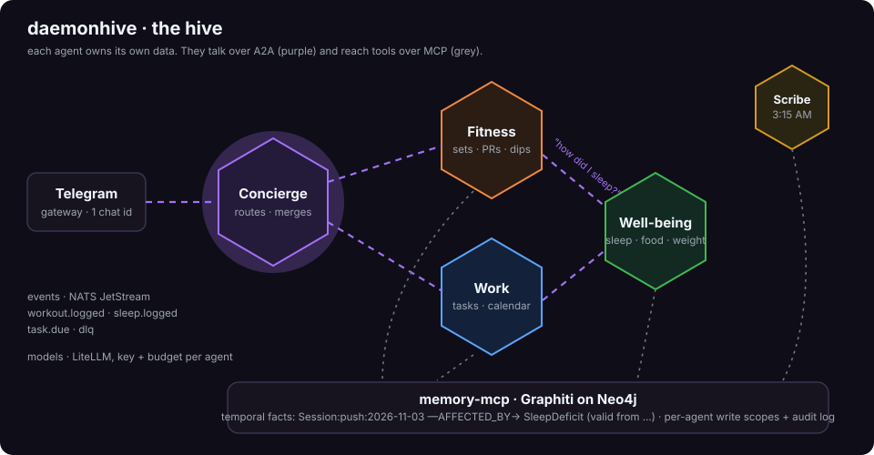
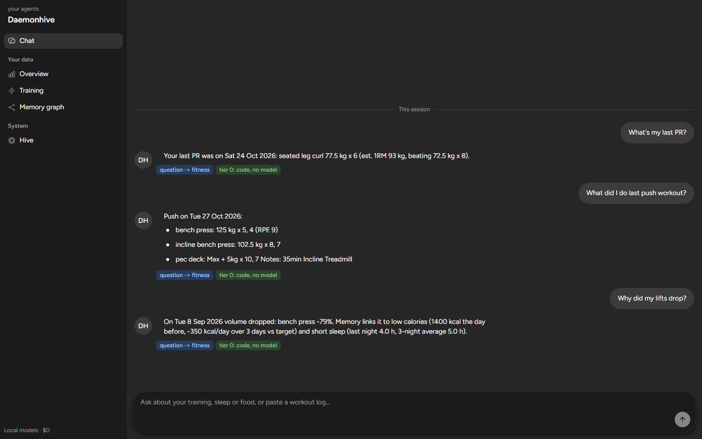
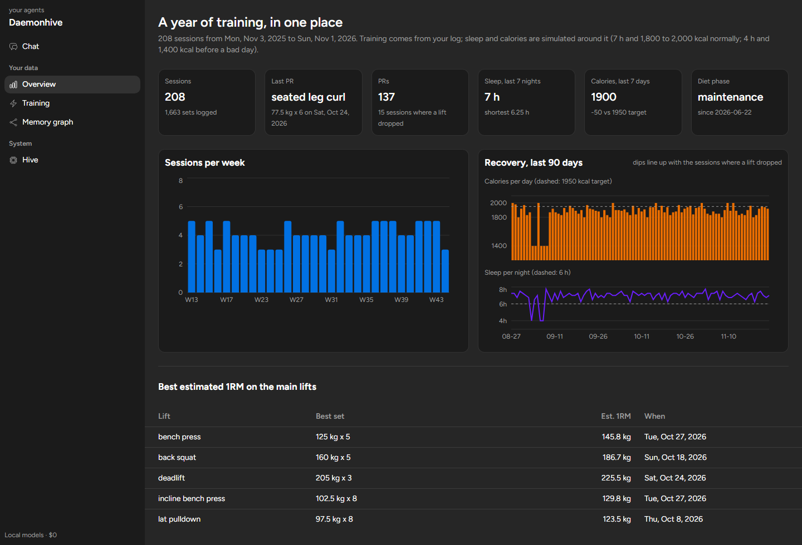
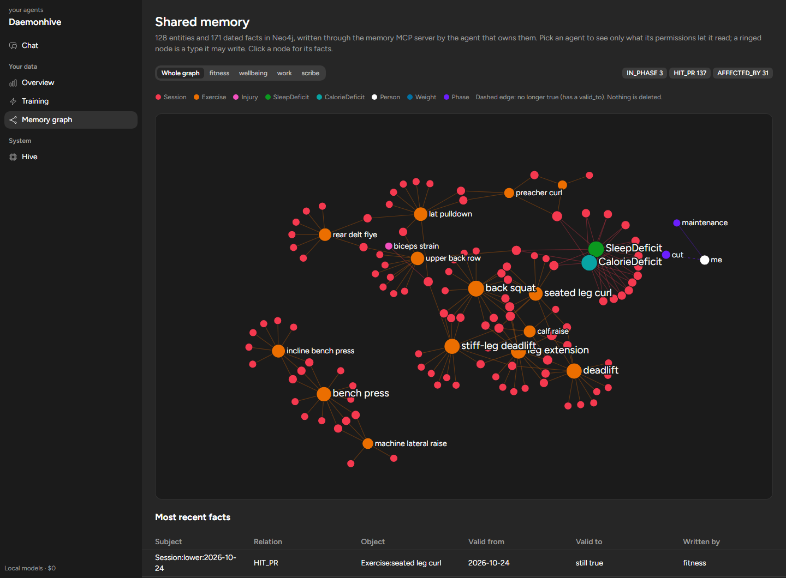
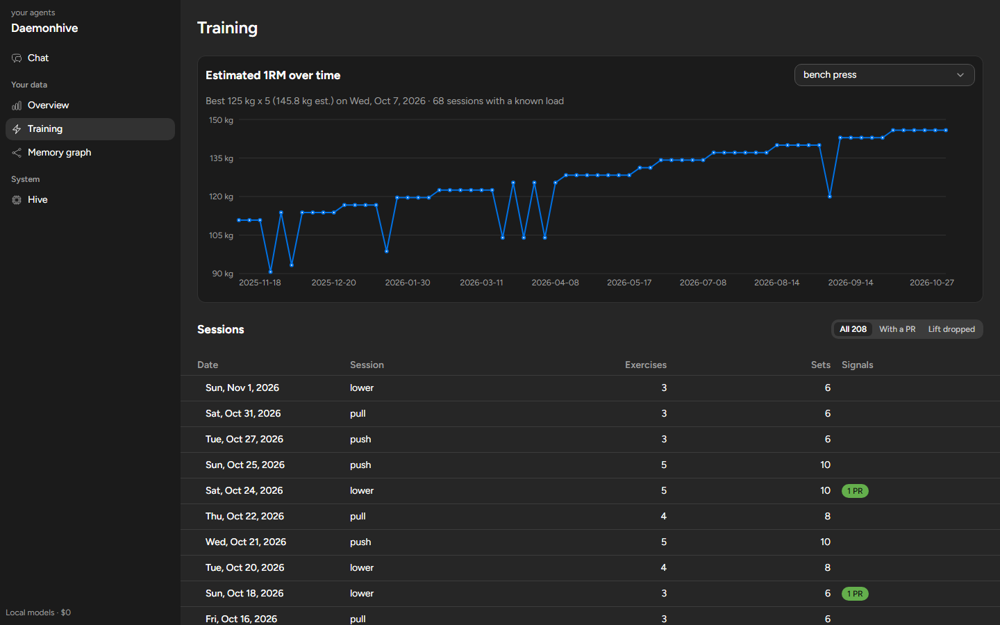
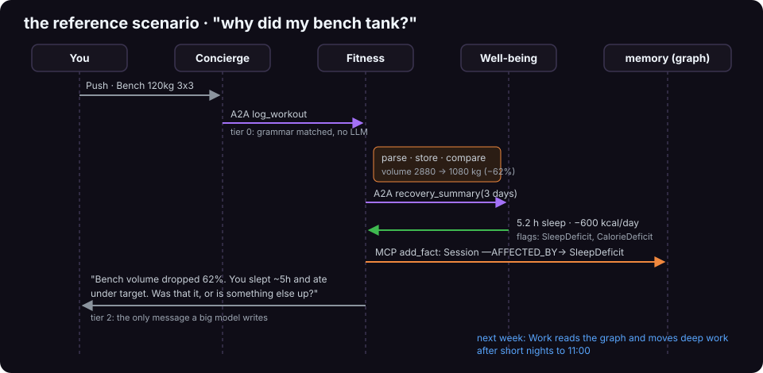

<div align="center">

# 🐝 daemonhive

**Five tiny AI agents that live on my laptop, remember a year of my training,<br>and gossip with each other over A2A instead of sharing a database.**

*Telegram + a web UI · local models · $0 · one memory graph that knows **when** things were true*

</div>


<sub>↑ one real message, animated: Concierge routes it with **no model**, Fitness asks Well-being over **A2A**, a dated fact is **born** in memory, and only then one local model writes the reply.</sub>

## meet the hive

| | agent | owns | ask it |
|---|---|---|---|
| 🟣 | **Concierge** | the conversation (Telegram + web UI) | *anything: it finds whoever owns the answer* |
| 🟠 | **Fitness** | workouts, PRs, progression | *"what's my last PR?" · "what did I do last push?" · "why did my bench drop?"* |
| 🟢 | **Well-being** | sleep, food, body weight, diet phase | *"how did I sleep this week?" · "am I cutting?"* |
| 🔵 | **Work** | tasks, calendar | *"plan my day" (deep work moves to 11:00 after a short night)* |
| 🟡 | **Scribe** | memory quality | *nobody asks Scribe. It merges duplicates and closes stale facts at night.* |

Each agent keeps **its own private database**. Need someone else's data? Ask them over **A2A**: you get an answer, never their tables.



## see it

<table>
<tr>
<td width="50%"><b>Chat</b>: every answer shows its route and whether a model was involved (usually not)<br></td>
<td width="50%"><b>Overview</b>: a year of training, sleep and calories at a glance<br></td>
</tr>
<tr>
<td><b>Memory graph</b>: 171 dated facts in Neo4j; flip the lens to see what each agent may read<br></td>
<td><b>Training</b>: estimated 1RM over time, every session, every PR<br></td>
</tr>
</table>

<sub>Screenshots run on <code>scenarios/demo-diary.txt</code>, a made-up year generated by <code>scenarios/make_demo_diary.py</code>. Same importer, same agents, nobody's real log.</sub>

---

## the one scenario that explains everything



1. I paste my push-day log into Telegram.
2. Concierge sees it matches the workout grammar and routes it to Fitness. **No LLM call.**
3. Fitness parses it, stores it, compares with the last push day: bench went from 3x8 to 3x3 at the same weight, **−62% volume**.
4. Fitness asks Well-being over A2A: *"recovery over the last 3 days?"* Well-being answers from its own DB: 5.2 h average sleep, 600 kcal/day under target.
5. Fitness writes `Session —AFFECTED_BY→ SleepDeficit` into the graph with a validity date and sends me one short, honest message.
6. Next morning, Work asks Well-being about last night and pushes my deep-work block to 11:00.

That scenario runs as a test (`tests/test_reference_scenario.py`) with the real agent logic and fake peers. It asserts the exact **trajectory** (`parse → MCP → A2A → memory → tier-2 message`), the **graph end state**, and what happens when Well-being is down (Fitness still reports the drop, just without the why).

---

## ask it things

Questions go to the agent that owns the data, on its `ask` skill:

```
you: what's my last PR?
hive: Your last PR was on Tue 27 Jan 2026: back squat 140 kg x 5 (est. 1RM 163.3 kg, beating 130 kg x 5).
      [question -> fitness | tier 0]

you: why did my lifts drop?
hive: On Mon 2 Feb 2026 volume dropped: bench press -76%. Memory links it to short sleep
      (last night 4.0 h) and low calories (1400 kcal the day before).   [tier 0]
```

*(numbers from the test fixture, not anyone's real log)*

The data is structured (sets, nights, meals, dated facts), so there's **no vector store: retrieval is a query.**

- **Common questions are code.** Last PR, last push / pull / leg day, best lift, progression, "when did I last…", how many sessions, biggest gains, why a lift dropped, sleep, calories, weight, diet phase: matched by pattern and answered from the agent's own tables. **Tier 0, under 2 s, no model.**
- **Everything else is a small tool loop** (`common/agentic.py`). The local model picks one of the agent's tools, sees the real numbers it returns, and answers. It can't invent a PR, because it never sees anything a tool didn't return.
- **Cross-domain questions** ("why did my bench drop?") go to Fitness, which reads the `AFFECTED_BY` facts it's allowed to read from memory.

## bring your own history

`daemonhive.importer` reads a free-text training diary, the kind you keep in a notes app, and it is forgiving on purpose:

| in the log | what it does |
|---|---|
| `March 9: Pull`, `19th March Lower:`, `23 October: Push 1` | session header, any date style, year rolls over |
| `Latpulldown 93kg 2x8-7` | 2 sets: 8 reps then 7 |
| `Flat Press 5 Plates 1x5`, `Triceps Pushdown Max + 12.3kg 1x7` | kept as a load note, never compared as kg |
| `Deadlift:` then `Top set 180kg x1` / `150kg 3x3` | sets on the following lines |
| `Upper:` with no date | dated between its neighbours, marked *date estimated* |
| `Next Lower: Squat 100kg 3x8` | a plan, not a workout: skipped |
| `140kg 1x1 Fail`, `RPE 1000000` | a miss is not a set; an RPE over 10 is a feeling, not a number |
| `2000kcal`, `sub 5h poor sleep`, `(Glute sprain)`, `Cut Phase 2 Start` | real calories, sleep, injuries and diet phases |

It stores the sessions in Fitness's database, simulates sleep and calories around them (a normal day vs the day before a session where a lift dropped; the diary's own numbers always win), and writes the facts each agent would have written, **as that agent**, through the memory server: PRs, drops linked to sleep or calorie deficits, injuries, body weight, diet phases.

```bash
docker compose --profile tools run --build --rm importer \
  python -m daemonhive.importer.run data/private/my-log.txt:2025 --dry-run   # see what it understood
```

`data/private/` is git-ignored.

## web UI

`ui/` is a React app on [Astryx](https://github.com/meta/astryx), Meta's open-source design system: Chat, Overview, Training, Memory graph, and **Hive** (Agent Cards, up/down, routing tiers, the memory audit log). Concierge serves the built app at `http://localhost:8100`.

The UI never touches a database. It reads Concierge's read-only `/api/*`, which asks the owning agent over A2A, and the graph comes from the memory server as a read-only `viewer`.

---

## MCP vs A2A, the short version

- **MCP** = agent → *tools and data*. Fitness talks to the `fitness-db` and `memory` MCP servers.
- **A2A** = agent → *another agent*. Each agent publishes an Agent Card at `/.well-known/agent-card.json` listing its skills and who may call them. The callee stays a black box with its own tools and memory.

Why not just let Fitness read the sleep table? Because then Fitness knows Well-being's schema, can read every meal I've logged, and breaks whenever that table changes. With A2A it gets exactly one aggregate, and only because it's on the skill's allow-list.

## memory that knows *when*

Neo4j behind `memory-mcp`. By default facts are written with plain Cypher (agents already hand memory a structured triple, so no LLM is needed); `MEMORY_BACKEND=graphiti` switches to LLM extraction for free text. Facts carry validity intervals, so "in a cut" doesn't get deleted when maintenance starts. It gets a `valid_to`, and you can ask what was true on any date.

Permissions are enforced **in the MCP server**, not the prompt (`mcp/permissions.py`):
- Fitness may write `Session`, `Exercise`, `Injury` facts and `AFFECTED_BY` / `HIT_PR` edges. It can't touch `Project` or read `Habit`.
- the web UI reads as `viewer`: everything, write nothing.
- every read and write, allowed or denied, lands in an audit log.
- a prompt injection hidden in a workout note can't widen any of that (there's a test for it).

## spend tokens only where code can't


Workout parsing is a grammar. Drop detection is arithmetic. Common questions are patterns. Only ambiguous routing hits a small model (nemotron 4B), and only open questions and the messages I actually read hit a bigger one (gemma 4 E4B). Locally, both run in LM Studio behind LiteLLM aliases; pointing the aliases at a hosted model is a config change (`deploy/litellm.yaml`). Per-agent LiteLLM keys with their own budgets are supported but need LiteLLM's key database, so locally every agent uses the proxy's master key.

---

## run it ($0, local models)

You need Docker, Python 3.11+, Node 22+ and [LM Studio](https://lmstudio.ai) with `google/gemma-4-e4b` and `nvidia/nemotron-3-nano-4b`.

```bash
cp .env.example .env              # set LITELLM_MASTER_KEY; Telegram optional
python -m venv .venv && . .venv/bin/activate && pip install -e ".[dev]"
pytest -q                         # 80 tests, no network
docker compose up -d --build      # 5 agents + memory + postgres + neo4j + nats + litellm
cd ui && npm install && npm run build && cd ..   # web UI at http://localhost:8100
```

Then either seed the reference scenario (`python -m scenarios.seed_demo`) or import your own diary (above), and ask away in the UI. With Docker Engine inside WSL, set `LMSTUDIO_API_BASE` to the Windows host's address on the WSL network (see `.env.example`).

Telegram: create a bot with @BotFather, put `TELEGRAM_BOT_TOKEN` and your `TELEGRAM_ALLOWED_CHAT_ID` in `.env`, then `docker compose --profile telegram up -d gateway`. The gateway answers exactly one chat id and never logs the token.

## layout

```
src/daemonhive/
  common/
    a2a.py            agent cards, task server/client, caller allow-lists
    agentic.py        the JSON tool loop for questions code can't answer
    memory_client.py  memory-mcp as one agent identity
    events.py         NATS subjects, idempotent consumer, dead-letter
    tiers.py          tier 0/1/2 + ledger
  agents/
    concierge/        rules-first routing, fan-out over A2A, the UI's read-only API
    fitness/          grammar parser, PR/drop records, Q&A, the scenario agent
    wellbeing/        recovery summary, log grammar, Q&A
    work/             deep-work planner + morning brief
    scribe/           entity merging, fact invalidation
  importer/           diary parser + recovery simulation + backfill through memory-mcp
  mcp/                memory server (Cypher / Graphiti), fitness-db, permission guard
  gateway/            telegram bot, one allowed chat id
ui/                   React 19 + Astryx web app
scenarios/            offline harness: real agents, fake peers
db/schema.sql         one schema per agent, one role per agent
deploy/helm/          a Deployment + Service + NetworkPolicy per agent, CronJobs
```

## status

- ✅ runs end to end on one machine with Docker + LM Studio, verified live: workout → A2A → memory → message, questions, the web UI, a year of imported history, an agent going down
- ✅ 80 tests, CI on every push (ruff, pytest, the reference scenario on its own)
- 🚧 not done yet: a cluster deployment (the Helm chart exists, nothing runs on k3s), Google Calendar for Work ([#2](https://github.com/ashcrowsz/daemonhive/issues/2)), an entity-resolution eval before Scribe merges anything ([#3](https://github.com/ashcrowsz/daemonhive/issues/3))

## things I would not do again

- start with five agents. Start with one, hand-written, and split only when one agent's context gets crowded.
- let agents share a database "temporarily". It's never temporary.
- trust the prompt as a permission boundary. It isn't one.
- reach for a vector store before checking whether the data is already structured. Mine was.

## license

MIT
